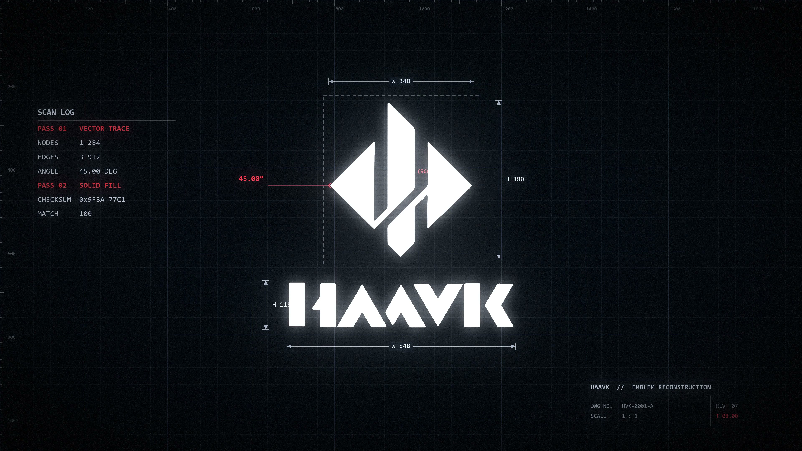

# HAAVK Launcher

为 Windows 上的 **DeepSeek 网页入口**加一段 HAAVK 启动动画。选择三种主题之一，以原声完整播放后在默认浏览器中打开 DeepSeek；按 `Esc` 可跳过剩余动画并立即打开网页。

这是独立的 Windows 动画启动器，通过快捷方式调用默认浏览器，不是 DeepSeek 官方插件，也不向网页注入代码。

**升级提示：** v1.0.3 起已下架 Codex 入口，仅保留 DeepSeek。升级用户请使用新版完整文件夹，并删除旧的 `Codex - HAAVK` 快捷方式。安装脚本不会自动清理旧入口。

## 三种 4K 动画

| 主题 | 完整时长 | 文件大小（字节） | 单独查看 / 下载 |
| --- | ---: | ---: | --- |
| HAAVK 01 | 33.0 秒 | 708,946,980 | [HAAVK_01_4K.mp4](https://github.com/hl3048174648-maker/haavk-launcher/releases/download/v1.0.4/HAAVK_01_4K.mp4) |
| HAAVK 02 | 30.8 秒 | 743,761,309 | [HAAVK_02_4K.mp4](https://github.com/hl3048174648-maker/haavk-launcher/releases/download/v1.0.4/HAAVK_02_4K.mp4) |
| HAAVK 03 | 29.8 秒 | 657,647,987 | [HAAVK_03_4K.mp4](https://github.com/hl3048174648-maker/haavk-launcher/releases/download/v1.0.4/HAAVK_03_4K.mp4) |

v1.0.4 使用作者提供的 **3840×2160、30 fps、H.264 + AAC** 文件，保留完整时长、音轨和文件字节，未重新编码或做画质压缩。此处 4K 指提供文件的像素尺寸。既有 1080p 文件未修改。



上图取自 HAAVK 03 的 4K 文件第 8 秒，是源视频取帧，不是启动器录屏。完整视频请使用上表中的 4K MP4 链接。

DeepSeek 入口使用官网鲸鱼图标。版本由快捷方式名称中的 01 / 02 / 03 区分。完整图标预览见[图标总览](docs/icons-preview.png)。

完整压缩包中的 `app/videos/HAAVK_01.mp4`、`HAAVK_02.mp4`、`HAAVK_03.mp4` 分别对应上表的 `_4K.mp4`，仅文件名不同，字节内容相同。普通启动窗口可能小于 4K；这只是显示缩放，不改变视频文件分辨率。最大化按当前显示器尺寸显示，并保持画面比例。

三个主题的窗口右上角均有最小化、最大化/还原和关闭按钮，叠放在视频上方；没有底部控制栏或进度条。视频始终保持原始比例，最大化时也不拉伸或裁切。视频里的百分比、终端文字和图表属于动画内容，不表示目标应用的加载状态。

## 开始使用

1. 下载 [HAAVK-Launcher-v1.0.4.zip 完整包](https://github.com/hl3048174648-maker/haavk-launcher/releases/download/v1.0.4/HAAVK-Launcher-v1.0.4.zip)（约 2 GB，已包含全部 4K 视频），解压并保留整个 `app` 文件夹。
2. 双击 `app/创建DeepSeek桌面快捷方式.vbs`。
3. 桌面会出现 `DeepSeek - HAAVK 01`、`DeepSeek - HAAVK 02` 和 `DeepSeek - HAAVK 03` 三个入口。双击喜欢的入口即可。

同名快捷方式已存在时，脚本会给新入口添加序号。移动 `app` 文件夹后，请重新创建快捷方式，并自行删除指向旧位置的入口。

DeepSeek 入口使用默认浏览器打开 <https://chat.deepseek.com/>。本项目不附带浏览器，也不处理网站登录。

GitHub 自动生成的 **Source code** 压缩包和 `git clone` 不包含 MP4。使用源码版本时，先在仓库根目录运行以下命令，再创建快捷方式：

```powershell
powershell -NoProfile -ExecutionPolicy Bypass -File .\app\source\download-videos.ps1
```

下载脚本按 [视频清单](app/videos/manifest.json) 获取发布的 4K 文件，并校验文件大小和 SHA-256。完整包用户无需再次下载视频。

## 操作

| 操作 | 效果 |
| --- | --- |
| 等待动画播完 | 自动打开目标 |
| `Esc` | 跳过剩余动画，立即打开目标；预览模式只结束预览 |
| `Enter` | 不触发跳过或关闭 |
| 右上角最小化按钮 | 隐藏到任务栏，动画和声音继续播放；播完仍会自动打开目标 |
| 右上角最大化/还原按钮 | 切换最大化和原窗口大小，保持视频原始比例 |
| 右上角 `×`、`Alt+F4` 或系统关闭窗口 | 取消本次启动，不打开目标 |
| 按住视频区域拖动 | 移动窗口 |

启动器始终开启原视频音轨；实际听到的音量仍取决于 Windows 音量和当前输出设备。

只想看动画时，双击 `app` 中的 `预览 HAAVK 01.vbs`、`预览 HAAVK 02.vbs` 或 `预览 HAAVK 03.vbs`。预览模式在片尾自动关闭，也可按 `Esc` 结束，不会打开目标。

如果视频无法播放，窗口中央会显示错误及 `Esc` 提示；启动模式按 `Esc` 继续打开目标，预览模式按 `Esc` 关闭。不要单独移动 EXE，`assets` 和 `videos` 必须与它位于同一目录。

## 环境与卸载

面向 Windows 10/11 桌面环境，使用 .NET Framework WPF 和系统的 H.264/AAC 播放支持。创建快捷方式需要 Windows Script Host；编译脚本使用 64 位 Windows 的 .NET Framework C# 编译器。

DeepSeek 网页需要默认浏览器和网络连接。动画本身从本地文件播放。

卸载时，删除本工具创建的快捷方式和解压目录即可。启动器不驻留，不添加开机启动项。

## 命令行与开发

从 `app` 目录运行：

```powershell
.\HAAVK-Launch.exe deepseek 02
.\HAAVK-Launch.exe --preview 03
```

目标只接受 `deepseek` 或 `--preview`，主题只接受 `01`、`02`、`03`。代码、编译脚本和测试位于 `app/source`，详见 [构建与测试](docs/build.md)。

## 许可与作者

- 启动器代码、脚本、文档和项目自绘几何图标：Copyright © 2026 [hl3048174648-maker](https://github.com/hl3048174648-maker)，采用 [MIT License](LICENSE)。
- DeepSeek 标识来自对应产品，权利属于其权利人，不适用本项目的 MIT 或视频许可；见[第三方标识说明](THIRD_PARTY_NOTICES.md)。
- 三部 HAAVK 动画由 [hl3048174648-maker](https://github.com/hl3048174648-maker) 原创并授权公开分享，采用 [CC BY 4.0](https://creativecommons.org/licenses/by/4.0/)。复用时请署名、链接许可证，并说明修改情况，详见 [视频资产许可](LICENSE-ASSETS.md)。

DeepSeek 名称用于说明启动目标。本项目与 DeepSeek 无官方关联。

## English

A standalone Windows animated launcher for the DeepSeek website. v1.0.4 uses the creator-supplied **3840×2160, 30 fps** files with their complete audio and duration, without re-encoding. The release MP4s and the files in the complete package are byte-identical; only their filenames differ. A smaller launcher window scales the display while the source files remain 4K.

All themes have top-right **minimize**, **maximize/restore**, and **close** buttons. Minimizing keeps playback running and still opens DeepSeek in the default browser at the end. Maximizing uses the current display and preserves the video's aspect ratio. **×** or **Alt+F4** cancels without opening the website.

The target opens when playback ends; **Esc** skips directly to it. **Enter** has no action. In preview mode, the end of playback or Esc closes the window without opening a target. Audible volume still depends on Windows volume and the selected output device.

The table above links directly to the three 4K MP4 release assets. The JPG is a frame extracted at 8 seconds from HAAVK 03, not a window recording.

The complete release ZIP is about 2 GB and includes all media. GitHub's automatic source archives and a source clone exclude MP4s: run `app/source/download-videos.ps1` to download and verify them against the size and SHA-256 values in `app/videos/manifest.json`.

Extract the complete package, then run `app/创建DeepSeek桌面快捷方式.vbs` to create three DeepSeek shortcuts. Keep the executable, `assets`, and `videos` together. This is an independent shortcut launcher, not an official plugin or an injected modification. Code and original geometric icons are MIT licensed; the HAAVK videos by **hl3048174648-maker** are licensed under **CC BY 4.0**.

From v1.0.3, the Codex entry is withdrawn and only DeepSeek is supported. Upgrading users should use the complete new folder and manually remove old `Codex - HAAVK` shortcuts; the installer does not remove them.

DeepSeek shortcuts use its official whale icon. The mark retains its owner's rights and is excluded from this project's licenses. See [third-party notices](THIRD_PARTY_NOTICES.md).
