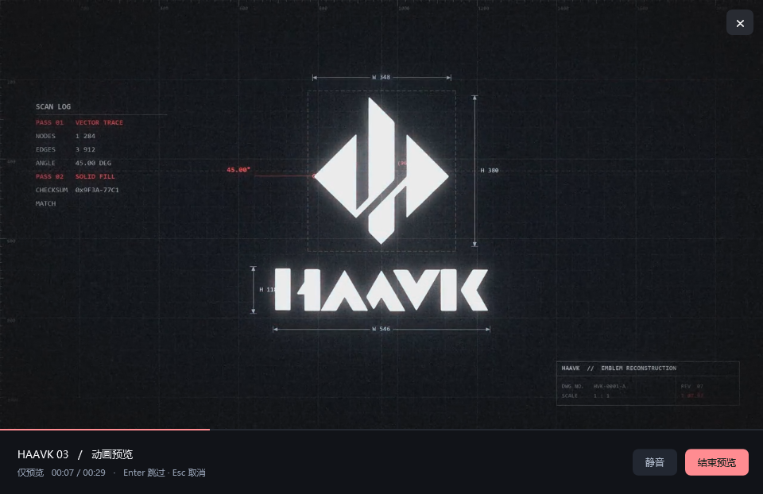

# HAAVK Launcher

为 Windows 上的 **Codex 桌面应用**和 **DeepSeek 网页**加一段 HAAVK 启动动画。选择三种主题之一，完整播放后自动打开目标，也可以随时跳过或取消。

这是独立的 Windows 动画启动器，不是官方插件，也不向 Codex 或 DeepSeek 注入代码。它通过 Windows 快捷方式工作，不修改目标应用。

## 三种动画

| 主题 | 完整时长 | 演示 |
| --- | ---: | --- |
| HAAVK 01 | 33.0 秒 | [观看演示](docs/demos/HAAVK-01-demo.mp4) |
| HAAVK 02 | 30.8 秒 | [观看演示](docs/demos/HAAVK-02-demo.mp4) |
| HAAVK 03 | 29.8 秒 | [观看演示](docs/demos/HAAVK-03-demo.mp4) |

以上演示录制实际运行的启动器预览窗口，包含视频、进度条和控制按钮，输出为 960×622 / 30 fps。演示采用每次启动的默认静音设置；随包动画保留原音轨，可通过窗口按钮开启声音。录制只覆盖启动器画面，不包含桌面或目标软件的私人内容。



三个主题使用独立配色图标，编号区分 01 / 02 / 03，C / D 分别表示 Codex / DeepSeek。完整图标预览见[图标总览](docs/icons-preview.png)。

随包视频为 **1280×720、30 fps、H.264 + AAC** 的轻量播放副本，保留完整内容、原始时长和 16:9 比例。仓库不包含体积较大的 1080p 原始媒体。

视频里的百分比、终端文字和图表属于动画内容；窗口底部的细线只表示视频播放进度，不表示目标应用的加载状态。

## 开始使用

1. 下载 [Releases](https://github.com/hl3048174648-maker/haavk-launcher/releases) 中的完整压缩包，解压并保留整个 `app` 文件夹。
2. 双击 `app/创建六个桌面快捷方式.vbs`。
3. 桌面会出现 `Codex - HAAVK 01/02/03` 和 `DeepSeek - HAAVK 01/02/03` 六个入口。双击喜欢的入口即可。

同名快捷方式已存在时，脚本会给新入口添加序号。移动 `app` 文件夹后，请重新创建快捷方式，并自行删除指向旧位置的入口。

Codex 入口打开本机已安装的 Codex MSIX 应用；DeepSeek 入口使用默认浏览器打开 <https://chat.deepseek.com/>。本项目不附带这两个应用，也不处理登录。

## 操作

| 操作 | 效果 |
| --- | --- |
| 等待动画播完 | 自动打开目标 |
| `Enter` 或“立即打开” | 跳过剩余动画，立即打开目标 |
| `Esc` 或右上角 `×` | 取消本次启动 |
| “静音”按钮 | 开启或关闭视频声音；每次运行默认静音 |
| 按住视频区域拖动 | 移动窗口 |

只想看动画时，双击 `app` 中的 `预览 HAAVK 01.vbs`、`预览 HAAVK 02.vbs` 或 `预览 HAAVK 03.vbs`。预览模式不会打开目标，`Enter` 只结束预览。

如果视频无法播放，窗口会显示错误；启动模式仍可点击“立即打开”。不要单独移动 EXE，`assets` 和 `videos` 必须与它位于同一目录。

## 环境与卸载

面向 Windows 10/11 桌面环境，使用 .NET Framework WPF 和系统的 H.264/AAC 播放支持。创建快捷方式需要 Windows Script Host；编译脚本使用 64 位 Windows 的 .NET Framework C# 编译器。

Codex 桌面应用需事先安装，DeepSeek 网页需要默认浏览器和网络连接。动画本身从本地文件播放。

卸载时，删除本工具创建的快捷方式和解压目录即可。启动器不驻留，不添加开机启动项。

## 命令行与开发

从 `app` 目录运行：

```powershell
.\HAAVK-Launch.exe codex 01
.\HAAVK-Launch.exe deepseek 02
.\HAAVK-Launch.exe --preview 03
```

目标只接受 `codex`、`deepseek` 或 `--preview`，主题只接受 `01`、`02`、`03`。代码、编译脚本和测试位于 `app/source`，详见 [构建与测试](docs/build.md)。

## 许可与作者

- 启动器代码、脚本、文档和项目自绘几何图标：Copyright © 2026 [hl3048174648-maker](https://github.com/hl3048174648-maker)，采用 [MIT License](LICENSE)。
- 三部 HAAVK 动画由 [hl3048174648-maker](https://github.com/hl3048174648-maker) 原创并授权公开分享，采用 [CC BY 4.0](https://creativecommons.org/licenses/by/4.0/)。复用时请署名、链接许可证，并说明修改情况，详见 [视频资产许可](LICENSE-ASSETS.md)。

Codex 和 DeepSeek 名称用于说明启动目标。本项目与 OpenAI、DeepSeek 无官方关联。

## English

A standalone Windows animated launcher for the installed Codex desktop app and the DeepSeek website. Three full-length HAAVK videos are included at 720p/30 fps. Playback starts muted; **Enter** skips to the target and **Esc** cancels. Preview mode never opens either target.

Extract the complete package, then run the shortcut installer in `app`. Keep the executable, `assets`, and `videos` together. This is an independent shortcut launcher, not an official plugin or an injected modification. Code and original geometric icons are MIT licensed; the original HAAVK videos by **hl3048174648-maker** are licensed under **CC BY 4.0**.
